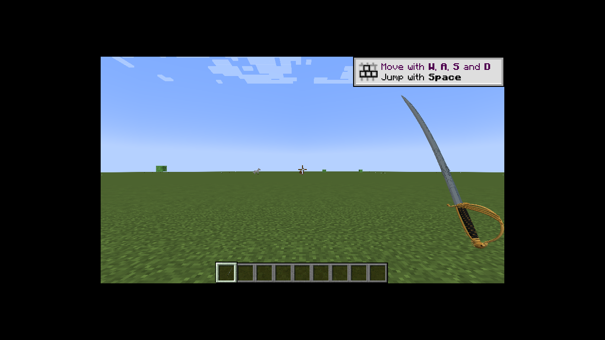
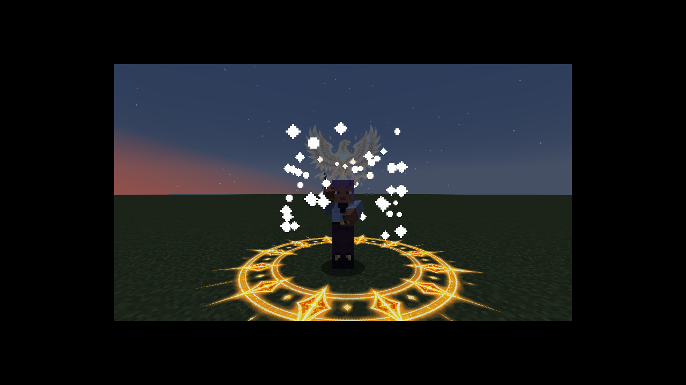
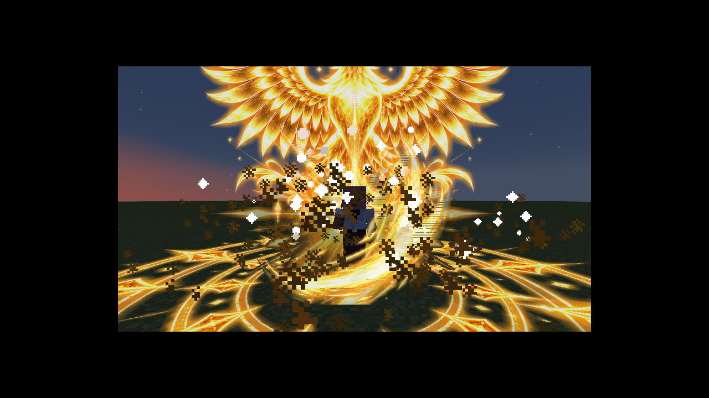

# 帝国鹰首军剑 · Forge 1.20.1

适用于 Minecraft 1.20.1、Forge 47.3.22 或更新的 47.x、Java 17。

- [下载模组 JAR](https://github.com/bggl68286-collab/musicfloat/raw/refs/heads/imperial-sabre-forge-1.20.1/minecraft/imperial-sabre/imperial_sabre-1.0.0.jar)：放入游戏实例的 `mods` 文件夹，无需解压。
- [下载整包](https://github.com/bggl68286-collab/musicfloat/raw/refs/heads/imperial-sabre-forge-1.20.1/minecraft/imperial-sabre/imperial_sabre-1.0.0-pack.zip)：模组、源码、中文说明、实机截图及校验文件。
- [下载源码 ZIP](https://github.com/bggl68286-collab/musicfloat/raw/refs/heads/imperial-sabre-forge-1.20.1/minecraft/imperial-sabre/imperial_sabre-1.0.0-source.zip) · [浏览源码](source/imperial-sabre-forge)

[中文安装和操作说明](README_中文.md) · [验证记录](VALIDATION.md)

左键挥砍；短按右键释放剑气；按住右键至少 1 秒后松开，释放鹰徽与金色冲击环。默认技能伤害较高，范围技能不伤害玩家，参数可在世界的服务器配置中调整。

## 实机画面

